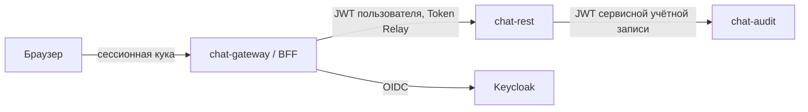

# AnonimChat

Учебный проект: микросервисный анонимный чат на Java 21 и Spring Boot 3.2. Основной акцент сделан на безопасности веб-приложения и наблюдаемости распределённой системы.

## Стек

| Область | Технологии |
| --- | --- |
| Backend | Java 21, Spring Boot, Spring Cloud Gateway, Spring Data JPA, WebSocket |
| Безопасность | Spring Security, Keycloak, OAuth 2.0, OIDC, JWT, BFF, Token Relay |
| Интеграции | REST, gRPC, RabbitMQ |
| Данные | PostgreSQL, Redis, Flyway |
| Наблюдаемость | OpenTelemetry, Micrometer, Tempo, Prometheus, Alertmanager, Loki, Alloy, Grafana |
| Инфраструктура | Docker Compose, Maven |

## Модули

| Модуль | Назначение | Порт |
| --- | --- | --- |
| `chat-gateway` | API Gateway и BFF, вход через Keycloak | 8088 |
| `chat-rest` | Основной REST API | 8089 |
| `chat-audit` | История событий и аудит | 8081 |
| `chat-matchmaker` | Подбор собеседников | 8082 |
| `chat-notification-service` | Уведомления | 8084 |
| `chat-grpc-analytics-server` | gRPC-сервер аналитики | |
| `chat-grpc-enrichment-client` | gRPC-клиент обогащения данных | |
| `chat-api-contract`, `chat-events-contract`, `chat-grpc-contract` | Общие контракты API, событий и gRPC | |

## Безопасность



- Браузер не получает токены: шлюз выдаёт сессионную куку с `HttpOnly` и `SameSite=Lax`.
- На шлюзе включена защита от CSRF.
- `chat-rest` проверяет JWT пользователя.
- В `chat-audit` токен пользователя не передаётся: сервис вызывается с отдельным JWT сервисной учётной записи.

## Наблюдаемость

- Сквозная трассировка: `X-Request-ID`, W3C Trace Context, экспорт в Tempo через OpenTelemetry Collector.
- Метрики в Prometheus, включая доменные метрики сервиса аудита.
- Структурированные JSON-логи, доставка в Loki через Alloy.
- Дашборд Golden Signals в Grafana, алерты и runbook.

Подробнее: [трассировка](docs/lab-06-tracing.md), [наблюдаемость](docs/lab-07-observability.md).

## Запуск

Нужны JDK 21, Maven и Docker.

```shell
docker compose up -d
mvn -DskipTests install
mvn -pl chat-audit spring-boot:run
mvn -pl chat-rest spring-boot:run
mvn -pl chat-gateway spring-boot:run
```

Каждый сервис запускается в отдельном терминале. Точка входа: `http://localhost:8088`.

Значения паролей и секретов в конфигурации предназначены только для локального запуска.
